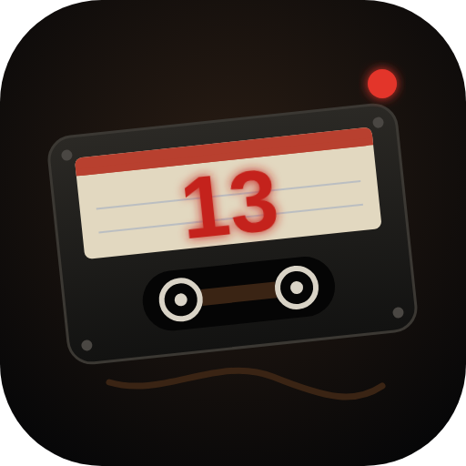

[Uploading ElevenLabs_2026-08-18T19_33_52_Adam - Distinct, Deep and Engaging_pvc_sp100_s50_sb75_se0_b_m2(2).mp3…]()
[Uploading ElevenLabs_2026-08-18T19_33_52_Adam - Distinct, Deep and Engaging_pvc_sp100_s50_sb75_se0_b_m2(1).mp3…]()

---

# Kazeta 13

Hororová hra z pohľadu prvej osoby, ktorá beží priamo v prehliadači. Po 26 rokoch sa vraciaš do domu, kde zmizla tvoja rodina. Zostali po nej iba VHS kazety a do niektorých sa dá vojsť.

**Hrať a stiahnuť:** https://cookisx682-dotcom.github.io/s1mle-/kazeta13/

Alebo si stiahni [Kazeta13.zip](kazeta13/Kazeta13.zip), rozbaľ ho a otvor `hra.html`. Najlepšie so slúchadlami.

- 7 dní, asi hodina hrania, 3 konce (jeden tajný)
- 6 príšer: Hosť, Matka, Mäsiar, Sestra, Dvojník, Hlásateľ
- Baterka, vypínače a bezpečné izby, schovávanie s mikrofónom, nôž
- Hádanky, poznámky, mapa, denník a zmeny v dome
- Svet preblikáva medzi realitou a anomáliou

**Ovládanie:** WASD pohyb · myš rozhliadanie · E použiť · F baterka · Shift beh · Tab taška · M mapa · Esc pauza

---

# Mechatronika

3D laboratórium v prehliadači. Rozober a zlož procesor diel po dieli a vyrob vlastný mikročip.

**Hrať:** https://cookisx682-dotcom.github.io/s1mle-/mechatronika/ (alebo otvor `mechatronika/index.html`)

- **Dielňa:** 10 dielov procesora (ventilátor, chladič, pasta, kryt, indium, čip, bumpy, kondenzátory, substrát, guličky BGA). Rozložený 3D pohľad, rez a test zapnutia s teplotou.
- **Výroba čipu:** 11 krokov od čistenia wafera po rezanie na čipy. Hotový čip potom zabalíš v Dielni.
- **Sprievodca:** po kliknutí vysvetlí každý diel a pri chybe povie, prečo to nejde.
- Pripravujem: motor auta, elektromotor, robotické rameno.

**Ovládanie:** ťahaj diel = vyber / vlož · klik = popis · myš = otáčanie a zoom
