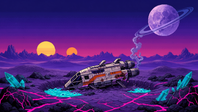

[Uploading ElevenLabs_2026-08-18T19_33_52_Adam - Distinct, Deep and Engaging_pvc_sp100_s50_sb75_se0_b_m2(2).mp3…]()
[Uploading ElevenLabs_2026-08-18T19_33_52_Adam - Distinct, Deep and Engaging_pvc_sp100_s50_sb75_se0_b_m2(1).mp3…]()

---

# Kazeta 13

Hororová hra z pohľadu prvej osoby, ktorá beží priamo v prehliadači. Po 26 rokoch sa vraciaš do domu, kde zmizla tvoja rodina. Zostali po nej iba VHS kazety a do niektorých sa dá vojsť.

**Hrať a stiahnuť:** https://cookisx682-dotcom.github.io/s1mle-/kazeta13/

Alebo si stiahni [Kazeta13.zip](kazeta13/Kazeta13.zip), rozbaľ ho a otvor `hra.html`. Najlepšie so slúchadlami.

- 7 dní, asi hodina hrania, 3 konce (jeden tajný)
- 6 príšer: Hosť, Matka, Mäsiar, Sestra, Dvojník, Hlásateľ
- Baterka, vypínače a bezpečné izby, schovávanie s mikrofónom, nôž
- Hádanky, poznámky, mapa, denník a zmeny v dome
- Svet preblikáva medzi realitou a anomáliou

**Ovládanie:** WASD pohyb · myš rozhliadanie · E použiť · F baterka · Shift beh · Tab taška · M mapa · Esc pauza

---

# Planéta Vex

2D pixel-art hra o stavbe továrne. Tvoja loď KX-13 núdzovo pristála na fialovej planéte Vex. Ťaž rudu, stav pásy a stroje, splň 5 fáz a postav raketu domov.

**Hrať:** https://cookisx682-dotcom.github.io/s1mle-/vex/ (alebo otvor `vex/index.html`)

- Vrták, pás, pec, rozdeľovač, výrobňa a montáž
- Ruda → ingoty → plechy, kolesá, drôt → obvody, motory → raketa
- 4 druhy rúd, vexit ďaleko od lode, minimapa, ručná ťažba, ukladanie postupu

**Ovládanie:** WASD chôdza · 1–6 stavby · R otočiť · Q zrušiť · ľavé = stavať · pravé = zbúrať · koliesko = priblíženie
